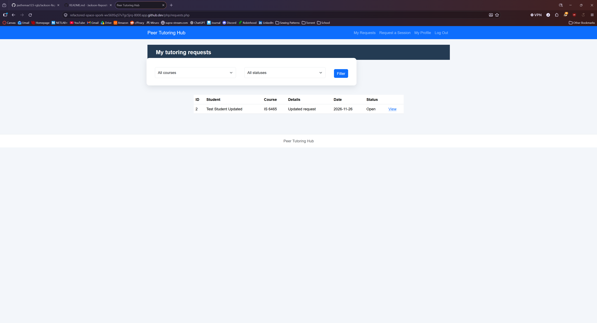

# Lab 7 Notes

## Part 1: Generate the Lab 7 Application

**[TODO: Open includes/auth.php and check requireLogin() against handout section 10 so you can explain the example below.]**

**AI prompt I used:**

> Generate code for all user management use cases UM-01 through UM-10 in the User Management Design Document.
>
> Use the Application Builder, Test Harness Generator, and Traceability Auditor documents as implementation guidance. Follow the authentication, authorization, session management, password hashing, CSRF protection, and role based access practices in the Authentication Reading Handout.
>
> Use lab6.zip as the existing Peer Tutoring Hub application to extend. Preserve the Lab 6 three tier architecture and update the application as needed to support user registration, login, logout, profile management, administrator access, and protected tutoring request workflows.
>
> Return a complete Lab 7 application package with all updated and new files.

**Uploaded source files:**

- Peer_Tutoring_Hub_User_Management_With_Diagrams.docx (User Management Design Document)
- application-builder.txt
- test-harness-generator.txt
- traceability-auditor.txt
- IS6465_Authentication_Reading_Handout_v1.2.pdf
- lab6.zip

**How Lab 7 extends Lab 6:**

Lab 7 keeps the same Lab 6 setup with pages in php/, SQL in repositories/, business rules in services/ and the database connection in config/db.php. It adds a users table that links to students through students.user_id, plus new pages for register, login, logout, profile, edit profile, change password and admin user management. All the old request pages now call requireLogin() and requireRole() from includes/auth.php, and every POST form has a CSRF token. Students only see and change their own requests, and the admin can see all of them.

**Example I verified:**

I checked the requireLogin() function in includes/auth.php against section 10 of the reading handout. It starts the session, sends you to login.php if there's no user_id, logs you out after 1200 seconds (20 minutes) of no activity, reloads the user from SQLite with findUserById() and kicks you out if the account isn't Active. That matches the handout code pretty much line for line. I also checked that registration only lets you pick Student or Tutor, which matches the design doc rule that public registration can't make an Administrator.

## Part 2: Set Up the Database

Commands I ran from lab7/database:

```
sqlite3 tutoring.db < setup-database.sql
sqlite3 tutoring.db < upgrade-to-user-management.sql
```

All three tables showed up (students, tutoring_requests and users).

```
sqlite> .tables
students           tutoring_requests  users
```

## Part 3: Create an Administrator Account

Command structure (real password left out):

```
php create-admin.php "Test Administrator" admin@example.com "<password with 12+ characters>"
```

The admin account was created. The script printed "Administrator account created. User ID: 1".

- Email used: admin@example.com
- Role assigned: Administrator

## Part 4: Run the Application

- URL I opened: https://refactored-space-spork-wv5695q57v7gc5jrq-8000.app.github.dev/
- The app opened fine after running php -S 0.0.0.0:8000 from the lab7 folder.
- Since I wasn't logged in, it sent me straight to the login page (php/login.php). The home page goes to profile.php, and profile.php redirects to login.php when there's no session.

## Part 5: Test the Student Workflow

**[TODO: Do every row in the table with the same test data (Test Student, student@example.com, name changed to Test Student Updated, IS 6465 / Exam review / Evening). Take the My Requests screenshot and save it as student-requests.png next to this file.]**

| Test | What I Did | Expected Result | Actual Result | Pass or Fail |
|---|---|---|---|---|
| Register student account | Clicked Create Account, entered Test Student, student@example.com, a 12+ character password twice, picked Student | Student account is created | Got "Your account was created and is Active" | Pass |
| Log in as student | Logged in with student@example.com and the password | Student can access protected student pages | Went to My Profile and the nav showed My Requests and Request a Session | Pass |
| View or update profile | Opened Edit Profile and changed the name to Test Student Updated | Profile information is displayed or saved | Profile showed "Your changes were saved" with the new name, role Student and status Active | Pass |
| Create tutoring request | Filled out the request form for IS 6465, Exam review, Evening, a date next week | A new request is created with status Open | Request #2 was created with status Open | Pass |
| Edit Open request | Clicked Edit, changed the details text and the date, saved | Updated request information is displayed | Details page showed the new text and date | Pass |
| View my requests | Clicked My Requests | Student sees the student's own requests | Only my request #2 showed, not the sample Maria Lopez request | Pass |
| Log out | Clicked Log Out | Session ends and login page appears | Went to the login page with "You have been logged out" | Pass |



## Part 6: Test the Administrator Workflow

**[TODO: Log in as admin, open Manage Users (screenshot as admin-users.png next to this file) and All Requests, log out, then type /php/requests.php and /php/admin-users.php in the address bar and check both go to login.]**

I logged in as admin@example.com, opened Manage Users and saw both the admin and the student account. Then I opened All Requests and saw every request, including the student's request and the sample Maria Lopez request. After that I logged out.

**What is authentication in this application?**
Authentication is the login part where the app checks who you are. login.php takes your email and password, authenticateUser() looks you up and uses password_verify() on the stored hash, and then the session saves your user_id so the app knows it's you on the next pages.

**What is authorization in this application?**
Authorization is what you're allowed to do after you're logged in. requireRole() checks your role on each page, and the request queries also check s.user_id so a student only gets their own requests.

**How is student access different from administrator access?**
A student can make requests and only view, edit or cancel their own Open ones. An admin can't make requests but can see every request, edit or cancel any Open one, and manage users (search, change role, activate/deactivate, delete).

**Which functions or pages should be limited to administrators?**
admin-users.php (Manage Users), admin-user.php (role and status changes), admin-delete-user.php (delete account), and seeing all tutoring requests. These match UM-03, UM-06, UM-07 and UM-08 in the design doc.

**What happens after logout if a user tries to visit a protected page directly?**
It sends you back to login.php. I tried going to requests.php and admin-users.php after logging out and both redirected to the login page because requireLogin() didn't find a user_id in the session.


## Part 7: Trace Registration and Login

**[TODO: Nothing to run. Open the files named below and read through them so you can explain the answers.]**

### Student registration workflow

- **Which file displays the Create Account form?** php/register.php
- **Which file receives the submitted registration form?** php/register.php also handles the POST (the top part of the file works as the registration controller).
- **Which file or function creates and verifies the CSRF token?** includes/auth.php. csrfToken() makes the token and verifyCsrfToken() checks it with hash_equals().
- **Which service validates the registration information?** services/userService.php, in validateRegistration() which gets called by registerUser().
- **Where is the password hashed?** In registerUser() in services/userService.php with password_hash($password, PASSWORD_DEFAULT).
- **Which repository files insert user and student data?** repositories/userPDO.php (insertUser) and repositories/studentPDO.php (insertStudentForUser).
- **Which database tables receive records when a student registers?** users and students.

### User login workflow

- **Which file displays the login form?** php/login.php
- **Which file receives the submitted login credentials?** php/login.php (it handles the POST too).
- **Which repository retrieves a user by email address?** repositories/userPDO.php with findUserByEmail().
- **Where is the submitted password verified?** In authenticateUser() in services/userService.php using password_verify().
- **What session actions occur after successful login?** loginSession() in includes/auth.php runs session_regenerate_id(true), saves user_id, display_name, role and last_activity in $_SESSION, makes the CSRF token, and then login.php redirects to profile.php.
- **Why should the application regenerate the session ID after login?** So an old session ID from before login can't be reused. That stops session fixation where someone gets you to use a session ID they already know.
- **How does the application determine whether the logged in user is a student or administrator?** requireLogin() reloads the user from the users table on every page and uses the role column. Pages then call requireRole() with the roles they allow.

**Why hashing and verifying belong in the application layer:**
The password hashing and checking happen in userService.php so every page that needs it (register, login, change password, create-admin) uses the same code and the same rules. If it was in the presentation page it would get copied around and could easily be done differently somewhere. The database setup script only builds tables and can't run password_hash(), so it shouldn't handle real passwords at all. Keeping it in the service layer also means the plain password never goes into SQL.

## Part 8: Run the Automated Tests

**[TODO: In a second terminal, cd lab7 and run the 3 test commands. Check you get 10 PASS, 28 PASS, and 18 PASS / 3 FAIL, and paste your output over this if anything differs.]**

```
$ php tests/validation-tests.php
<p>Valid time: PASS</p><p>Missing time: PASS</p><p>Altered value: PASS</p><p>Multiple valid topics: PASS</p><p>Missing topics: PASS</p><p>Altered topic: PASS</p><p>Minimum length: PASS</p><p>Maximum length: PASS</p><p>Too short: PASS</p><p>Too long: PASS</p>

$ php tests/user-management-tests.php
PASS UM-01 student registration creates Active user
PASS UM-01 email stored in lowercase
PASS UM-01 password stored as hash
PASS UM-01 student registration creates linked students row
PASS UM-01 duplicate email rejected
PASS UM-01 public registration cannot create Administrator
PASS UM-01 password mismatch rejected
PASS UM-01 password under 12 characters rejected
PASS UM-01 tutor registration creates user with no students row
PASS UM-09 valid login accepted
PASS UM-09 wrong password rejected
PASS UM-09 unknown email rejected
PASS UM-02 own profile retrieved by user_id
PASS UM-04 name update saved to users and students
PASS UM-04 duplicate email rejected
PASS UM-04 profile edit cannot change role
PASS UM-05 wrong current password rejected
PASS UM-05 new password works and old one fails
PASS Admin script creates Administrator
PASS UM-06 administrator changes role
PASS UM-06 invalid role rejected
PASS UM-06 last active administrator role protected
PASS UM-07 inactive user cannot log in
PASS UM-07 reactivated user can log in
PASS UM-07 last active administrator cannot be deactivated
PASS UM-08 delete blocked by related tutoring requests
PASS UM-08 account with no requests deleted
PASS UM-08 last active administrator cannot be deleted
All user management checks passed

$ php tests/integration-tests.php
PASS UC01 create and Open
PASS Lab 4 checkbox values preserved
FAIL Duplicate email reuses student
FAIL UC02 course and status filter
PASS Invalid reason rejected
FAIL Invalid submission writes nothing
PASS Edit Open request
PASS Updated reason persisted
PASS Cancel Open request
PASS Cancelled row retained
PASS Second cancellation rejected
PASS Unrelated request unchanged
PASS FK enforced
PASS UC02 empty filter result
PASS Lab 7 request linked to logged in student
PASS Lab 7 student cannot view another student request
PASS Lab 7 student list shows only own requests
PASS Lab 7 administrator list shows all requests
PASS Lab 7 student cannot cancel another student request
PASS Lab 7 student cannot edit another student request
PASS Lab 7 student edits own Open request
FAILURES: 3
```

- **Validation tests:** all 10 passed.
- **User management tests:** all 28 passed.
- **Integration tests:** 18 passed and 3 failed.

**Failed integration tests:**

1. **Duplicate email reuses student** checks that submitting two requests with the same email only makes one student row. It expects 1 student, but setup-database.sql already adds a sample student (Maria Lopez), so there are 2.
2. **UC02 course and status filter** checks that filtering IS 6465 and Open returns the 2 requests the test made. The sample Maria Lopez request is also IS 6465 and Open, so it returns 3.
3. **Invalid submission writes nothing** checks that a bad request doesn't get saved by counting rows. It expects 2, but there are 3 because of the sample request.

All three come from the sample data in setup-database.sql, not from the app actually doing the wrong thing. The same 3 tests also fail in the original Lab 6 files. What needs looking at is whether the setup script should have sample rows in it, or whether the tests should count rows before and after instead of expecting a fixed number. I didn't change the test files.

## Part 9: Use the AI Skills Pack Process

**[TODO: On the login page press F12, delete the hidden csrf_token value and try to log in. Check you get "Invalid form token" (used in the Test Harness Generator answer). Read the prompts, responses and evaluations below.]**

### Application Builder

**Prompt:**
> Explain how a student registration request moves from register.php through authentication checks, PHP services, repositories, PDO, and SQLite in the Peer Tutoring Hub application. Identify the responsibility of each file or layer.

**AI response:**
> 1. **Browser → php/register.php (presentation and controller):** register.php shows the Create Account form with a hidden csrf_token field. When the form is posted, it calls verifyCsrfToken($_POST) and then registerUser(openDatabase(), $_POST). It shows errors or a confirmation message.
> 2. **includes/auth.php (authentication helpers):** startSecureSession() starts the session with httponly and samesite cookie settings. csrfToken() creates the token and verifyCsrfToken() compares it with hash_equals() and returns 403 if it doesn't match.
> 3. **config/db.php (connection):** openDatabase() creates the PDO connection to database/tutoring.db, turns on exception mode and runs PRAGMA foreign_keys = ON.
> 4. **services/userService.php (business rules):** validateRegistration() checks the name, email format, password length (12+), matching passwords, that the role is only Student or Tutor, and that the email isn't already used. registerUser() hashes the password with password_hash() and starts a transaction.
> 5. **repositories/userPDO.php and repositories/studentPDO.php (data access):** insertUser() runs a prepared INSERT into users with status Active. For students, insertStudentForUser() inserts the linked students row (or linkStudentToUser() links an existing Lab 6 student with the same email).
> 6. **SQLite (data tier):** the users row stores the hash, role and status, and the students row stores user_id as a foreign key back to users. If anything fails, the transaction is rolled back so you don't get a user with no student row.

**Statement I verified:** The AI said registerUser() hashes the password with password_hash() before anything is inserted. I checked services/userService.php and that's right: it calls password_hash($data['password'], PASSWORD_DEFAULT) and passes the hash to insertUser(). In the database the password_hash column starts with $2y$, so it's a bcrypt hash and not the plain password.

### Traceability Auditor

**Prompt:**
> Trace the requirement "a student can register, log in, create a tutoring request, and log out" through the presentation pages, authentication code, services, repositories, SQLite tables, and automated tests in this project.

**AI response (summary):**
> Registration goes register.php → verifyCsrfToken() → registerUser()/validateRegistration() → insertUser() and insertStudentForUser() → users and students. Login goes login.php → verifyCsrfToken() → authenticateUser() → findUserByEmail() → users, then loginSession() regenerates the session ID. Creating a request goes request-form.php/process-request.php → requireLogin(), requireRole(Student), verifyCsrfToken() → submitRequest() and validateSubmission() → findStudentByUserId() and insertTutoringRequest() → tutoring_requests. Logout goes logout.php → verifyCsrfToken() → logoutSession() which clears the session, expires the cookie and calls session_destroy(). Registration, login and request creation are covered by automated tests. Logout has no automated test, so it is only verified by the manual test.

| Requirement | Presentation Page | Authentication or Authorization | Service or Validation | Repository or SQL | Database Table | Test Evidence |
|---|---|---|---|---|---|---|
| Student registers an account | php/register.php | verifyCsrfToken() in includes/auth.php | registerUser(), validateRegistration() in userService.php | insertUser() in userPDO.php, insertStudentForUser() in studentPDO.php | users, students | user-management-tests: "UM-01 student registration creates Active user", "UM-01 student registration creates linked students row" (PASS), plus my manual Part 5 test |
| Student logs in | php/login.php | verifyCsrfToken(), loginSession() with session_regenerate_id(true) | authenticateUser() with password_verify() | findUserByEmail() in userPDO.php | users | "UM-09 valid login accepted", "UM-09 wrong password rejected" (PASS), plus manual test |
| Student creates a tutoring request | php/request-form.php, php/process-request.php | requireLogin(), requireRole(['Student']), verifyCsrfToken() | submitRequest(), validateSubmission() in requestService.php | findStudentByUserId(), insertTutoringRequest() | students, tutoring_requests | integration-tests: "Lab 7 request linked to logged in student" (PASS), plus manual test |
| User logs out | php/logout.php (Log Out button in nav.php) | verifyCsrfToken(), logoutSession() | none | none | none (session only) | No automated test. Manual test: logged out and then requests.php redirected to login.php |

### Test Harness Generator

**Prompt:**
> Suggest one useful test case for authentication or authorization in the Peer Tutoring Hub application. The test must relate to registration, login, logout, session protection, role based access, password validation, CSRF protection, or account status.

**AI response:**
> **Test: A POST without a valid CSRF token is rejected and changes nothing.** Log in as a student, then send a POST to process-request.php (or login.php) with valid form values but a missing or wrong csrf_token. Expected result: a 403 response with "Invalid form token" and no new row in tutoring_requests. This checks verifyCsrfToken() in includes/auth.php.

**Is it already covered?** No. None of the three test files test CSRF. verifyCsrfToken() calls exit, so the command line tests can't really call it directly.

**How I'd test it:** Manually, I'd open the login page, use the browser dev tools to delete or change the hidden csrf_token value and submit. I tried this kind of request and got a 403 with "Invalid form token. Go back, refresh the page and try again." To automate it you'd need a test that sends real HTTP requests to the running server, or split the token check into a function that returns true/false so a CLI test can call it.

**Is it appropriate?** Yes. The handout lists CSRF as one of the main protections and the lecture even has "valid session with missing CSRF token → 403 and no update" as a test case, so it fits this app.

### Skills Pack Reflection

Using AI helped me follow the code a lot faster since it pointed out which file does what, like register.php handing off to userService.php and then the repositories. The traceability table was useful because it showed logout and CSRF don't have automated tests, which I wouldn't have noticed just by running the tests. But I still had to open the files to make sure the function names were real and the steps were in the right order. AI can sound sure about stuff that's wrong or made up, and the integration test failures showed that "tests exist" doesn't mean they're correct for this database. So you always have to check what the AI says against the actual requirements and code.

## Part 10: Inspect the Database

**[TODO: From the lab7 folder run sqlite3 database/tutoring.db, paste the lab query, and check you get the same 2 rows. Then .quit.]**

```
sqlite> SELECT u.user_id, u.full_name, u.email, u.role, u.status, s.student_id, s.student_name, s.student_email
   ...> FROM users AS u LEFT JOIN students AS s ON u.user_id = s.user_id ORDER BY u.user_id;
user_id  full_name             email                role           status  student_id  student_name          student_email
-------  --------------------  -------------------  -------------  ------  ----------  --------------------  -------------------
1        Test Administrator    admin@example.com    Administrator  Active
2        Test Student Updated  student@example.com  Student        Active  2           Test Student Updated  student@example.com
```

**What the LEFT JOIN does:** It returns every row from users even if there's no matching student. When there's no match, the student columns just come back empty (NULL), which is why the admin row has blanks.

**How users connects to students:** students has a user_id column that references users(user_id). Each student row points to one user account.

**Why account info is stored separately from student profile info:** The users table is for logging in (email, password hash, role, status) and covers every type of user, while students holds the tutoring profile that requests link to. Tutors and admins need accounts but aren't students, and keeping them separate also kept the Lab 6 students and tutoring_requests tables working without changing them.

**Why an admin may not have a students row:** Admins don't submit tutoring requests, so they don't need a student profile. The app only creates a students row when someone registers as a Student, and create-admin.php only inserts into users.
